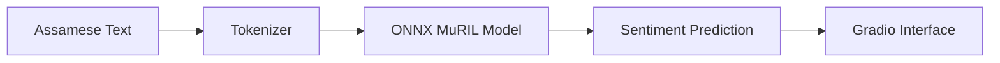
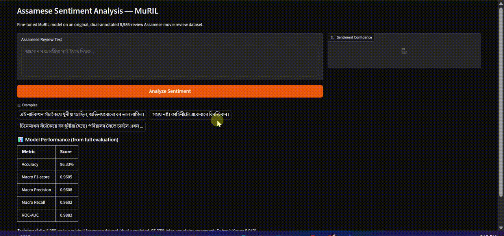

# Assamese Sentiment Analysis — Live Demo

[](https://www.python.org/)
[](https://www.gradio.app/)
[](https://onnx.ai/)
[](https://huggingface.co/AvinabhDutta-Dev/assamese-sentiment-muril-onnx)
[](https://huggingface.co/datasets/AvinabhDutta-Dev/assamese-movie-reviews-sentiment)

## Overview

An interactive Gradio application for binary sentiment classification of Assamese text using a fine-tuned MuRIL model converted to ONNX format.

The demo allows users to enter Assamese text and view the model's predicted sentiment. The ONNX model is hosted on Hugging Face Hub and loaded at runtime, making this repository a lightweight interface for exploring Assamese sentiment analysis.

The 96.33% accuracy reported in the associated research project is a research result; it should not be interpreted as a separately measured accuracy score for the live application.

## Table of Contents

- [Overview](#overview)
- [Model and Evaluation](#model-and-evaluation)
- [ONNX Model](#onnx-model)
- [Running Locally](#running-locally)
- [How It Works](#how-it-works)
- [Demo Screenshots](#demo-screenshots)
- [Related Projects and Resources](#related-projects-and-resources)
- [Limitations](#limitations)

## Model and Evaluation

Uses [AvinabhDutta-Dev/assamese-sentiment-muril](https://huggingface.co/AvinabhDutta-Dev/assamese-sentiment-muril), one of five models benchmarked in a comparative study on an original, dual-annotated 8,986-review Assamese movie review dataset.

## Running Locally

```bash
pip install -r requirements.txt
python app.py
```
Then open `http://127.0.0.1:7860` in your browser.

## How It Works

The application follows a simple inference pipeline:

1. **Text input:** The user enters an Assamese sentence.
2. **Tokenization:** The input is converted into tokens suitable for MuRIL.
3. **ONNX inference:** The converted model processes the tokenized text.
4. **Prediction:** The application displays the predicted sentiment and associated scores.



## ONNX Model

This demo uses an ONNX-converted version of the fine-tuned MuRIL model, hosted on Hugging Face:

**[AvinabhDutta-Dev/assamese-sentiment-muril-onnx](https://huggingface.co/AvinabhDutta-Dev/assamese-sentiment-muril-onnx)**

The ONNX format was chosen specifically to reduce memory footprint for lightweight CPU deployment — the original, fully documented PyTorch model (with complete evaluation results and model card) is available separately at [AvinabhDutta-Dev/assamese-sentiment-muril](https://huggingface.co/AvinabhDutta-Dev/assamese-sentiment-muril).

The model is loaded directly from Hugging Face Hub at runtime — no model files are stored in this repository.

## Live Demo

The GIF below demonstrates the Gradio interface, Assamese text input, and the sentiment prediction workflow using the fine-tuned MuRIL model converted to ONNX.



**Try the demo:** [Open the live application](YOUR_RENDER_APP_URL)


## Related Projects and Resources

- 🔬 [Full project (5-model comparison)](https://github.com/AvinabhDutta-Dev/assamese-sentiment-analysis)
- 📊 [Dataset](https://huggingface.co/datasets/AvinabhDutta-Dev/assamese-movie-reviews-sentiment)
- 🤗 [Model](https://huggingface.co/AvinabhDutta-Dev/assamese-sentiment-muril)
- 🤗 [Model](https://huggingface.co/AvinabhDutta-Dev/assamese-sentiment-muril-onnx)

## Limitations

- The model may misclassify sarcasm, negation, mixed-language text, or sentences that require broader context.
- The research model's reported accuracy does not guarantee correct predictions for individual inputs.
- Inputs longer than the model's supported sequence length may be truncated.
- This application is a research demonstration, not a replacement for human interpretation of nuanced language.
